<!-- Every image lives on the `output` branch, rebuilt daily by .github/workflows/profile.yml.
     The project cards and the stack come from scripts/data.mjs: edit it, then run `node scripts/build.mjs --readme`. -->

  <a href="https://dambox.ch"><picture><source media="(max-width: 1011px)" srcset="https://raw.githubusercontent.com/davidnussio/davidnussio/output/hero-mobile.svg" /></picture></a>

  
  
  
  
  

I'm David, a software engineer in Lugano. With **[dambox Sagl](https://dambox.ch)** I build **[bizCARD](https://bizcard.ch)** and a handful of apps for phone, TV and desktop. In the open I maintain developer tools around jq, secrets and Effect. Everything below is in active development.

<!-- projects:start -->
### Products

Built and run by <a href="https://dambox.ch">dambox Sagl</a>, in Ticino.

  <a href="https://bizcard.ch"><picture><source media="(max-width: 1279px)" srcset="https://raw.githubusercontent.com/davidnussio/davidnussio/output/card-bizcard-wide.svg" /></picture></a>
  <a href="https://divano.dambox.ch"><picture><source media="(max-width: 1279px)" srcset="https://raw.githubusercontent.com/davidnussio/davidnussio/output/card-divano-wide.svg" /></picture></a>
  <a href="https://pace.dambox.ch"><picture><source media="(max-width: 1279px)" srcset="https://raw.githubusercontent.com/davidnussio/davidnussio/output/card-pace-wide.svg" /></picture></a>
  <a href="https://bus.oggi.ch"><picture><source media="(max-width: 1279px)" srcset="https://raw.githubusercontent.com/davidnussio/davidnussio/output/card-lugo-wide.svg" /></picture></a>
  <a href="https://web-croc.web.app"><picture><source media="(max-width: 1279px)" srcset="https://raw.githubusercontent.com/davidnussio/davidnussio/output/card-webcroc-wide.svg" /></picture></a>

### Desktop apps

Native apps made with Bun and Electrobun.

  <a href="https://ingombro.dambox.ch"><picture><source media="(max-width: 1279px)" srcset="https://raw.githubusercontent.com/davidnussio/davidnussio/output/card-ingombro-wide.svg" /></picture></a>
  <a href="https://github.com/davidnussio/aitelier"><picture><source media="(max-width: 1279px)" srcset="https://raw.githubusercontent.com/davidnussio/davidnussio/output/card-aitelier-wide.svg" /></picture></a>
  <a href="https://github.com/davidnussio/arkimind-releases"><picture><source media="(max-width: 1279px)" srcset="https://raw.githubusercontent.com/davidnussio/davidnussio/output/card-arkimind-wide.svg" /></picture></a>

### Developer tools

Open source, around jq, secrets and Effect.

  <a href="https://jq.dambox.ch"><picture><source media="(max-width: 1279px)" srcset="https://raw.githubusercontent.com/davidnussio/davidnussio/output/card-jq-playground-wide.svg" /></picture></a>
  <a href="https://envsec.dev"><picture><source media="(max-width: 1279px)" srcset="https://raw.githubusercontent.com/davidnussio/davidnussio/output/card-envsec-wide.svg" /></picture></a>
  <a href="https://github.com/davidnussio/lazyjq"><picture><source media="(max-width: 1279px)" srcset="https://raw.githubusercontent.com/davidnussio/davidnussio/output/card-lazyjq-wide.svg" /></picture></a>
  <a href="https://effect-cqrs.dambox.ch"><picture><source media="(max-width: 1279px)" srcset="https://raw.githubusercontent.com/davidnussio/davidnussio/output/card-effect-cqrs-wide.svg" /></picture></a>
  <a href="https://davidnussio.github.io/oauth-simulator/"><picture><source media="(max-width: 1279px)" srcset="https://raw.githubusercontent.com/davidnussio/davidnussio/output/card-oauth-lab-wide.svg" /></picture></a>

<b>The same projects as a list, with all the links</b>

 

| Project | What it is | Links |
| --- | --- | --- |
| **bizCARD** | Digital business cards for teams | [site](https://bizcard.ch) |
| **Divano** | IPTV player for phone and Android TV | [site](https://divano.dambox.ch) · [Google Play](https://play.google.com/store/apps/details?id=ch.dambox.divano) |
| **Pace** | Running pace calculator | [site](https://pace.dambox.ch) |
| **LuGo** | Real-time bus departures in Lugano | [site](https://bus.oggi.ch) · [repo](https://github.com/davidnussio/lugano-timetable) |
| **WebCroc** | Peer-to-peer file transfer in the browser | [site](https://web-croc.web.app) |
| **Ingombro** | Disk space analyzer for macOS | [site](https://ingombro.dambox.ch) · [repo](https://github.com/davidnussio/ingombro) |
| **AItelier** | AI image studio with consistent styles | [repo](https://github.com/davidnussio/aitelier) |
| **Arkimind** | Smart AI document filing | [releases](https://github.com/davidnussio/arkimind-releases) |
| **jq Playground** | jq notebook for VS Code | [site](https://jq.dambox.ch) · [repo](https://github.com/davidnussio/vscode-jq-playground) · [Marketplace](https://marketplace.visualstudio.com/items?itemName=davidnussio.vscode-jq-playground) |
| **envsec** | Secrets in the OS keychain instead of .env files | [site](https://envsec.dev) · [repo](https://github.com/davidnussio/envsec) · [npm](https://www.npmjs.com/package/envsec) |
| **lazyjq** | Terminal UI to explore JSON with jq | [repo](https://github.com/davidnussio/lazyjq) |
| **effect-cqrs** | CQRS and event sourcing for Effect v4 | [site](https://effect-cqrs.dambox.ch) · [repo](https://github.com/davidnussio/effect-cqrs) · [npm](https://www.npmjs.com/package/effect-cqrs) |
| **OAuth Lab** | Interactive OAuth 2.0 and OpenID Connect simulator | [site](https://davidnussio.github.io/oauth-simulator/) · [repo](https://github.com/davidnussio/oauth-simulator) |

<!-- projects:end -->

<b>More from the workshop</b>

 

| Project | What it does |
| --- | --- |
| [effect-cqrs-http-example](https://github.com/davidnussio/effect-cqrs-http-example) | The HTTP example of the effect-cqrs integration guide, as a runnable server |
| [effect-cqrs-kms](https://github.com/davidnussio/effect-cqrs-kms) | Google Cloud KMS master key for effect-cqrs personal data, runnable |
| [effect-audit-tool](https://github.com/davidnussio/effect-audit-tool) | LLM security auditor in four phases (triage, deep audit, red-team validation, remediation), SARIF 2.1.0 output |
| [github-stars-organizer](https://github.com/davidnussio/github-stars-organizer) | Semantic search over your GitHub stars: Effect-TS, SQLite and embeddings |
| [ai-decisions](https://github.com/davidnussio/ai-decisions) | Claude skill that records architectural decisions and syncs them to `CLAUDE.md`, Cursor, Copilot and Kiro |
| [spectra-scope](https://github.com/davidnussio/spectra-scope) | VST3 plugin (JUCE, C++) for FL Studio: spectrum, oscilloscope, goniometer, loudness |
| [dotfiles](https://github.com/davidnussio/dotfiles) | My macOS machine in one script: fish, Ghostty, Neovim, zellij, mise |
| [homebrew-tap](https://github.com/davidnussio/homebrew-tap) | Homebrew formulae for my CLIs |

<!-- stack:start -->
### Stack

  <picture><source media="(max-width: 1279px)" srcset="https://raw.githubusercontent.com/davidnussio/davidnussio/output/stack-languages-wide.svg" />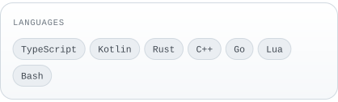</picture>
  <picture><source media="(max-width: 1279px)" srcset="https://raw.githubusercontent.com/davidnussio/davidnussio/output/stack-web-wide.svg" />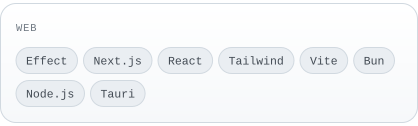</picture>
  <picture><source media="(max-width: 1279px)" srcset="https://raw.githubusercontent.com/davidnussio/davidnussio/output/stack-data-infra-wide.svg" />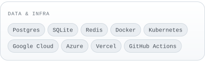</picture>
  <picture><source media="(max-width: 1279px)" srcset="https://raw.githubusercontent.com/davidnussio/davidnussio/output/stack-daily-drivers-wide.svg" />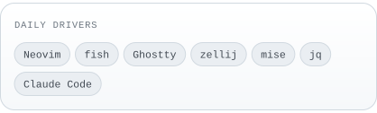</picture>

<!-- stack:end -->

### On GitHub

  
  

  <picture>
    <source media="(prefers-color-scheme: dark)" srcset="https://raw.githubusercontent.com/davidnussio/davidnussio/output/snake-dark.svg" />
    <source media="(prefers-color-scheme: light)" srcset="https://raw.githubusercontent.com/davidnussio/davidnussio/output/snake.svg" />
    
  </picture>

  Made by David Nussio · <a href="https://dambox.ch">dambox Sagl</a>, Lugano

