<!-- Cards live on the `output` branch, rebuilt daily by .github/workflows/profile.yml -->

<p align="center">
  
</p>

<p align="center">
  <a href="https://bizcard.ch">
    
  </a>
</p>

<p align="center">
  <a href="https://bizcard.ch"></a>
  <a href="https://dambox.ch"></a>
  <a href="https://x.com/davidnussio"></a>
  <a href="https://marketplace.visualstudio.com/publishers/davidnussio"></a>
  <a href="https://www.npmjs.com/~davidnussio"></a>
  
</p>

---

### 👋 Hi, I'm David

```ts
const david = {
  basedIn: "Lugano, Switzerland 🇨🇭",
  building: { company: "dambox Sagl", product: "bizCARD", url: "https://bizcard.ch" },
  speaks: ["TypeScript", "Effect-TS", "Next.js", "Bun", "Kotlin", "a bit of Rust and C++"],
  cares: ["typed errors", "developer tooling", "infrastructure as code", "good CLIs"],
  onGitHubSince: 2010,
} as const;
```

- 🏗️ Building **[bizCARD](https://bizcard.ch)**: digital business cards for teams, with dynamic QR codes and Microsoft Entra ID SSO / SCIM provisioning. Next.js, Postgres, Vercel and the AI SDK, made in Ticino.
- 🧩 Maintaining **[jq Playground](https://marketplace.visualstudio.com/items?itemName=davidnussio.vscode-jq-playground)**, a jq notebook inside VS Code: 33k+ installs, ★ 4.7.
- 🔐 Shipping **[envsec](https://envsec.dev)**, secrets in your OS keychain instead of `.env` files.
- 📺 Publishing **[Divano](https://divano.dambox.ch)** on Google Play, an IPTV player that comes with no content of its own.
- 🤖 Lately: CQRS and event sourcing on Effect v4, Android apps in Kotlin, native desktop apps with Bun, AI-assisted developer tools.

### 🚀 Featured projects

<table>
  <tr>
    <td width="50%" valign="top">
      <a href="https://github.com/davidnussio/vscode-jq-playground"></a>
      <br />
      <a href="https://marketplace.visualstudio.com/items?itemName=davidnussio.vscode-jq-playground"></a>
      <a href="https://marketplace.visualstudio.com/items?itemName=davidnussio.vscode-jq-playground&ssr=false#review-details"></a>
      <a href="https://jq.dambox.ch"></a>
      <br />
      <sub>Write jq filters notebook-style, pick a data source (file, URL, shell command) and see results instantly. Copilot-powered explain/fix.</sub>
    </td>
    <td width="50%" valign="top">
      <a href="https://github.com/davidnussio/envsec"></a>
      <br />
      <a href="https://www.npmjs.com/package/envsec"></a>
      <a href="https://www.npmjs.com/package/envsec"></a>
      <a href="https://envsec.dev"></a>
      <br />
      <sub>Secrets in macOS Keychain, Linux Secret Service or Windows Credential Manager. Run commands with interpolation, GPG sharing, a TUI. <code>brew install davidnussio/tap/envsec</code></sub>
    </td>
  </tr>
  <tr>
    <td width="50%" valign="top">
      <a href="https://github.com/davidnussio/ingombro"></a>
      <br />
      
      
      <a href="https://ingombro-web.vercel.app"></a>
      <br />
      <sub>Disk space analyzer with an animated treemap. Finds <code>node_modules</code>, <code>target</code>, <code>__pycache__</code> and friends, and gets your gigabytes back.</sub>
    </td>
    <td width="50%" valign="top">
      <a href="https://github.com/davidnussio/effect-cqrs"></a>
      <br />
      <a href="https://www.npmjs.com/package/effect-cqrs"></a>
      
      <a href="https://davidnussio.github.io/effect-cqrs/"></a>
      <br />
      <sub>My 2019 <code>moleculer-cqrs</code>, ported to Effect v4: commands decide on events, events are the only source of truth, read models are projections you can rebuild. An experiment, with an <code>LLMS.md</code> for coding agents.</sub>
    </td>
  </tr>
</table>

### 📱 On your phone and TV

<table>
  <tr>
    <td width="50%" valign="top">
      <a href="https://divano.dambox.ch"><b>📺 Divano</b></a>
      <br />
      <a href="https://play.google.com/store/apps/details?id=ch.dambox.divano"></a>
      <a href="https://divano.dambox.ch"></a>
      
      <br />
      <sub>An IPTV player for Android TV and phones that comes with no content: bring your own playlist, or try the demo. Optional sync through dambox's server or your own.</sub>
    </td>
    <td width="50%" valign="top">
      <a href="https://pace.dambox.ch"><b>🏃 Pace</b></a>
      <br />
      <a href="https://pace.dambox.ch"></a>
      
      <br />
      <sub>Running pace for the track: pace, reps, 400 m splits and training zones. Offline, no account.</sub>
    </td>
  </tr>
</table>

<details>
<summary><b>🧪 More from the workshop</b></summary>
<br />

| Project | What it does |
| --- | --- |
| [effect-audit-tool](https://github.com/davidnussio/effect-audit-tool) | LLM security auditor in four phases (triage, deep audit, red-team validation, remediation), SARIF 2.1.0 output |
| [oauth-simulator](https://davidnussio.github.io/oauth-simulator/) | Interactive OAuth 2.0 and OpenID Connect lab: real flows against an authorization server running in a Service Worker (in Italian) |
| [github-stars-organizer](https://github.com/davidnussio/github-stars-organizer) | Semantic search over your GitHub stars: Effect-TS, SQLite and embeddings |
| [ai-decisions](https://github.com/davidnussio/ai-decisions) | Claude skill that records architectural decisions and syncs them to `CLAUDE.md`, Cursor, Copilot and Kiro |
| [spectra-scope](https://github.com/davidnussio/spectra-scope) | VST3 plugin (JUCE, C++) for FL Studio: spectrum, oscilloscope, goniometer, loudness |
| [dotfiles](https://github.com/davidnussio/dotfiles) | My macOS machine in one script: fish, Ghostty, Neovim, zellij, mise |
| [homebrew-tap](https://github.com/davidnussio/homebrew-tap) | Homebrew formulae for my CLIs |

</details>

### 🧰 Toolbox

<p align="center">
  
  <br />
  
  <br />
  
</p>

<p align="center">
  
  
  
  
  
</p>

### 📊 On GitHub

<p align="center">
  
  
</p>

<p align="center">
  
</p>

<p align="center">
  <picture>
    <source media="(prefers-color-scheme: dark)" srcset="https://raw.githubusercontent.com/davidnussio/davidnussio/output/snake-dark.svg" />
    <source media="(prefers-color-scheme: light)" srcset="https://raw.githubusercontent.com/davidnussio/davidnussio/output/snake.svg" />
    
  </picture>
</p>

---

<p align="center">
  <sub>Made by David Nussio · <a href="https://dambox.ch">dambox Sagl</a> — also building <a href="https://bizcard.ch">bizCARD</a>, digital business cards for companies.</sub>
  <br /><br />
  
</p>


